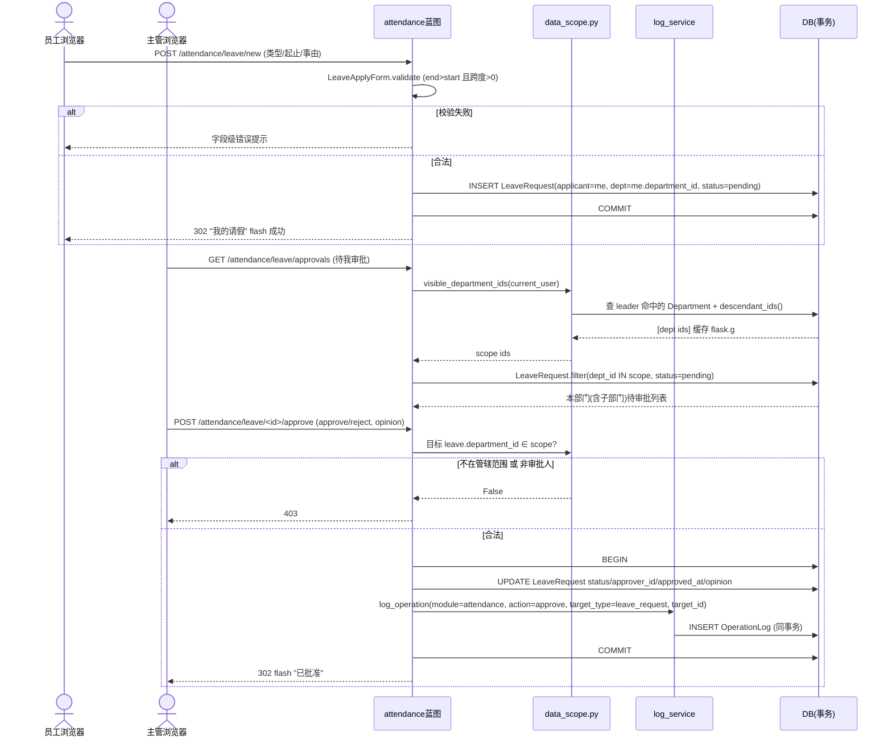
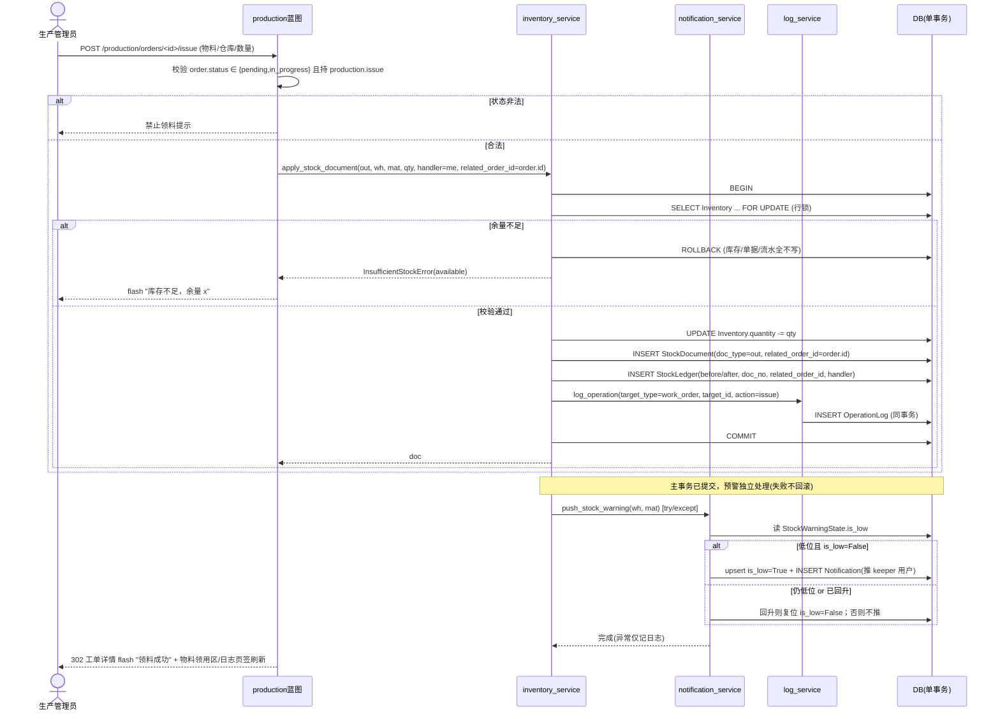
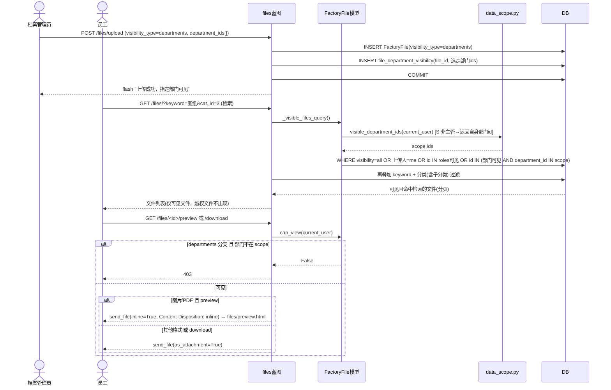
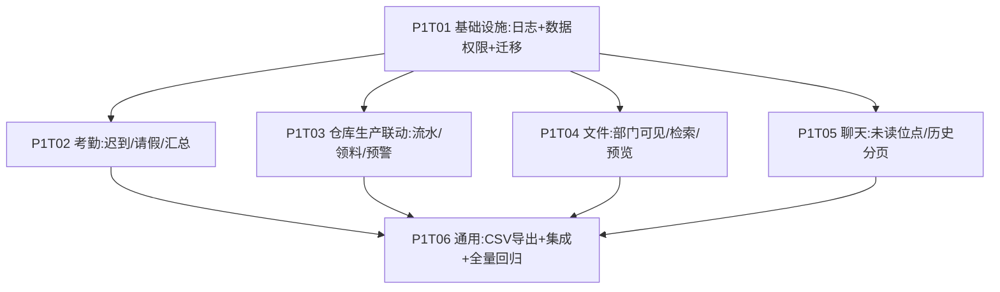

# P1 增量架构设计 + 任务分解：小型工厂管理系统

> 架构师：高见远 ｜ 依据：`docs/PRD-P1.md` v1.0（16 条原子需求 P1-01~P1-16）+ `docs/ARCHITECTURE.md`（P0 架构基线）
> 代码基线：P0 已交付 `c9c27e5`（98 pytest 用例 + 39 冒烟项全过，2026-10-23）
> 增量原则：**收窄式增强 + 预埋点复用**，P0 十蓝图 / 18 表 / 全部既有行为零回归
> 默认假设：A1~A5 已由主理人拍板，本设计按其执行（详见 §8 边界说明）

---

## 0. 现场核验结论（设计前置）

本设计已现场逐文件核验 P0 代码，确认以下**可直接复用的预埋点**（不推倒、不重构）：

| 预埋点 | 位置 | 现状 | P1 用法 |
|---|---|---|---|
| `base_employee_query()` | `app/routes/hr.py:21` | 已存在，直接 `return User.query` | 在此一处注入员工部门过滤（P1-04） |
| `base_order_query()` | `app/routes/production.py:14` | 已存在，直接 `return WorkOrder.query` | 在此一处注入工单部门过滤（P1-04） |
| `Department.descendant_ids()` | `app/models/org.py:42` | 已实现递归 BFS 取本部门+全部子孙 id | 数据权限 / 文件部门可见 / 考勤汇总统一复用（A5） |
| `StockDocument.related_order_id` | `app/models/warehouse.py:61` | 字段+FK 已建，`inventory_service` 已接收并 `or None` 规范化 | P1-05/P1-08 直接启用，零迁移成本 |
| `FactoryFile.visibility_type` + `file_role_visibility` | `app/models/file.py:8,45` | `all/roles` 两值 + 关联表 + `can_view()` + `_visible_files_query()` | 扩 `departments` 第三值，复用单一出口（P1-10） |
| `PERMISSION_REGISTRY` | `app/utils/permissions.py:18` | 权限点唯一声明，四处共用 | 新增 7 点只改此处（§7.1） |
| `time_utils.now()` | `app/utils/time_utils.py:20` | Asia/Shanghai naive，统一取时 | 所有新增时间字段一律复用，禁止散落 `datetime.now()` |
| `flask.g` 权限缓存 | `app/utils/permissions.py:81` | 请求内缓存权限码 | 部门可见 id 集合同样缓存在 `flask.g`，避免重复递归 |
| alembic 单头 `d220c1496af3` | `migrations/versions/` | `factory_mgmt_init`，`down_revision=None` | 新增一条 P1 迁移挂在其后（§6） |
| `OperationLog` 载体诉求 | PRD M6 | P0 无此表，但架构已明确"P1 统一日志表" | 新建一表，同时服务 P1-15 与 P1-06（§1.1-①） |

**关键发现（影响设计）**：`attendance` 蓝图**没有** `base_query` 出口（月度/汇总直接查 `AttendanceRecord.query` / `User.query`），P1 需**新增一个** `base_attendance_query()` 与 `base_user_query()` 出口，与此前两个出口统一命名（§1.1-②）。

---

## Part A · 增量系统设计

## 1. 增量实现方案

### 1.1 总体策略

1. **最小变更**：所有读查询收窄集中在 `base_query` / `*_visible_query` 单一出口；所有新增写操作经 service 层；新增权限点只在 `PERMISSION_REGISTRY` 声明。
2. **预埋点优先**：`related_order_id`、`descendant_ids()`、`file_role_visibility`、`visibility_type`、`time_utils`、既有事务服务全部复用，杜绝平行实现。
3. **一表双用**：`OperationLog` 同时承载全局日志（P1-15）与工单日志（P1-06），以 `target_type/target_id` 区分，不建第二张日志表。
4. **批次内并行、批次间依赖**：P1T01 基础设施（日志+数据权限）先行；P1T02~P1T05 四个业务域在 T01 完成后可并行；P1T06 导出与集成收尾。
5. **零回归**：不改动任何 P0  Blueprint 已发布的 URL / 表单字段 / 权限码语义；`related_order_id=NULL`、旧 `visibility_type=all/roles` 继续正常工作。

### 1.2 八项关键设计决策（逐条）

---

#### ① OperationLog 统一日志表：一表双服务（P1-15 + P1-06）

**模型**（新建 `app/models/system.py`）：
```
OperationLog(id, operator_id FK→users, module, action,
             target_type, target_id, summary, ip, created_at)
INDEX(module, created_at) / INDEX(operator_id, created_at)
INDEX(target_type, target_id, created_at)   ← 工单日志按此索引过滤
```

**双服务机制**：
- **P1-15 全局日志**：`/system/logs` 用 `module / operator_id / 时间区间 / action` 四维筛选，只读分页。
- **P1-06 工单日志**：工单详情"操作日志"页签用固定条件 `target_type='work_order' AND target_id=<工单ID>` 查询同一张表，倒序展示。索引 `(target_type, target_id, created_at)` 保证该查询走索引。
- **关系**：`operator_id` 是普通 FK 到已有 `users` 表（不新建用户维度）；`target_id` 为**多态整型**（无 FK 约束）——因为目标可能是工单/员工/单据/请假，统一用 `(target_type, target_id)` 描述，避免为每类目标建反向关系。这与 P0 的 `StockDocument.related_order_id` 设计哲学一致。

**写入纪律**（`app/services/log_service.py` 的唯一入口 `log_operation()`）：
- 调用方在**业务事务内**调用（不自行 commit），日志与业务数据**同事务提交**；失败操作不写成功日志（在校验通过、状态变更之后调用）。
- 日志表**只读**：全项目无 edit/delete 路由，只有 service 的 append。
- 记录事件分类（action 枚举见 §7.2）：`create/update/transition/approve/issue/import/export/login`。

---

#### ② 数据权限收窄机制（P1-04）

**统一出口**：新建 `app/utils/data_scope.py`，提供三个纯函数，**只注入读查询**：

```
visible_department_ids(user) -> list[int] | None   # None=不收窄(superadmin/非leader)
apply_dept_scope(query, model, user, dept_column)  # 向 query 追加 IN 过滤，返回 query
is_scoped_leader(user) -> bool                     # leader 角色 且 是某 Department.leader_id
```

**判定逻辑**：
- `superadmin` → 返回 `None`（完全豁免，全量）。
- 持 `leader` 角色且 `user.id` 命中任一 `Department.leader_id` → 返回 **该部门及其全部子孙** id（复用 `Department.descendant_ids()`，A5），一次递归后缓存到 `flask.g`、`_scope_dept_ids_<uid>`。
- 其他角色 → 返回 `None`（维持 P0 现状），**不因缺少 `attendance.view_all` 而越权**：数据权限与功能权限是**交集**——先过 `@permission_required`，再过部门收窄。

**单一出口注入点（仅 4 处读出口）**：
| 出口 | 文件 | 过滤列 |
|---|---|---|
| `base_employee_query()` | `hr.py` | `User.department_id IN scope` |
| 新增 `base_attendance_query()` / `base_user_query()` | `attendance.py` | `AttendanceRecord.user_id` / `User.department_id` |
| `base_order_query()` | `production.py` | `WorkOrder.related_department_id IN scope`（无值回退负责人部门，见 A5） |

**工单归部门判定（A5）**：新增 `WorkOrder.related_department_id`，建/编辑表单可选；**为空时回退** `leader.department_id`。SQL 用 `coalesce` 一次表达，避免 Python 层 N+1：
```python
from sqlalchemy import func, or_
dept_col = func.coalesce(WorkOrder.related_department_id,
                         db.session.query(User.department_id).filter(User.id == WorkOrder.leader_id).scalar_subquery())
query = apply_dept_scope_raw(query, dept_col, ids)  # dept_col IN ids
```
scalar 子查询在单条 SQL 内完成，无逐行查询。

**防绕过**：
- 所有列表/汇总/审批/导出**必须**从上述出口取 query，Code Review checklist 强制；测试用"篡改 dept_id 参数"用例验证结果被静默收窄（不 403、不越权，对齐 P1-03/P1-04 验收）。
- 写操作（新建/审批 POST）的权限判定**不**走数据权限，而是路由层显式校验目标是否落在 `visible_department_ids` 内，否则 403（对齐 P1-01 "非审批人 403"）。

---

#### ③ 请假审批状态机 + 迟到判定落库时机

**请假状态机（单级，A3）**：`pending → approved | rejected`（终态，无二次流转）。超管可代批（superadmin 功能权限放行，但仍记录 `approver_id=超管`）。

**落库时机**：
- 提交申请：`LeaveRequest(department_id=申请人部门, status='pending')`，校验 `start_at < end_at` 且跨度>0（字段级错误）。
- 审批：`approve` / `reject` 写入 `approver_id / approved_at / approve_comment / status`，同时 `log_operation(module='attendance', action='approve'...)`。
- **请假豁免判定（与 P1-02 联动）**：不回溯改写历史打卡记录，而在**统计与判定查询时**按 `(user_id, 时段与请假区间重叠 AND status='approved')` 排除——即 `attendance_service` 的月度统计与迟到汇总先取当月已批准请假日集合，命中日不计缺卡、不判迟到早退。这样阈值调整/审批状态变化不污染已落库的原始打卡数据。

**迟到/早退判定落库时机（P1-02 关键约束）**：
- **落库在打卡写入那一刻**（`POST /attendance/clock` 的 service 内），**不在渲染时实时计算**。这样阈值配置后续调整不影响历史判定。
- 阈值集中在 `config.py`：`SHIFT_START='09:00'`、`SHIFT_END='18:00'`、`LATE_GRACE_MIN=15`、`EARLY_GRACE_MIN=15`、`WORKDAYS=(0..4)`（A2）。
- 判定服务 `attendance_service.evaluate_record(record)`：签到晚于 `09:15` → `late_minutes = 超时分钟数`、`day_status` 含"迟到"；签退早于 `17:45` → `early_leave_minutes`、`day_status` 含"早退"；正常 → 状态"正常"、两值为 0；缺卡/请假日不判。
- `day_status` 允许组合位（如 "迟到,早退"），用逗号分隔短码存储，统计时按 `late_minutes>0` / `early_leave_minutes>0` 计数（不依赖状态字符串解析）。

---

#### ④ StockLedger 与库存增减同事务一致性（P1-07/08/05）

**核心原则**：流水**不是**独立写入，而是嵌入 P0 既有 `apply_stock_document()` 事务的**最后一步**，与其原子绑定。

**改造 `app/services/inventory_service.py`**：在现有事务块（`with_for_update()` 行锁 → 校验 → 更新 `Inventory` → 写 `StockDocument`）内，`commit()` 之前追加：
```
before = 变动前 inv.quantity（入库新建时按 A4 记 0）
after  = 变动后 inv.quantity
INSERT StockLedger(warehouse_id, material_id, doc_type, quantity,
                   before_balance=before, after_balance=after,
                   doc_no, related_order_id, handler_id, created_at=now())
```
- 任何一步失败 → 整体 rollback，库存/单据/流水**三者同时回滚**，不会出现"库存变了没流水"。
- **不可变审计**：无 update/delete 路由；`StockLedger` 无 `is_active` 字段（与软删业务表区分）。
- **领料场景**：`production.issue` 不另写库存逻辑，直接调用 `apply_stock_document(doc_type='out', related_order_id=order_id, handler_id=current_user)`——复用同一事务、行锁、不足回滚；事务内再写一条 `OperationLog(target_type='work_order', action='issue')`。因此"领料 = 出库单据 + 流水 + 工单日志"三步原子。
- **一致性边界（明确告知）**：绕过单据/领料直接改库（如后台脚本改 `Inventory.quantity`）不产生流水，这是约定边界，非缺陷。

---

#### ⑤ 库存预警 Notification 去重与失败隔离（P1-09）

**载体**：新建独立 `Notification` 表（A3：与人对人 `ChatMessage` 分离），`notif_type='stock_warning'`，字段含 `receiver_id / title / content / material_id / warehouse_id / is_read / link_url / created_at`。顶部角标 = 聊天未读（P1-14）+ 预警未读**聚合**。

**去重状态**：新增 `StockWarningState(warehouse_id, material_id, is_low, last_notified_at)`，`UNIQUE(warehouse_id, material_id)`（A4）。
- 单据提交成功（`inventory_service` 的 commit **之后**触发，见失败隔离）→ 计算 `inv.quantity <= inv.warn_threshold`：
  - 在低库存且 `is_low=False` → upsert `is_low=True`，推送一条 Notification（内容含物料/仓库/当前量/阈值）。
  - 在低库存且 `is_low=True` → **不推送**（低位期间只一次）。
  - 已回升（`quantity > threshold`）→ 复位 `is_low=False`，使下次跌破可再推。

**失败隔离（A4）**：预警推送逻辑包在 `notification_service.push_stock_warning()` 内，由路由 `try/except` 包裹，**在库存主事务提交成功后**调用；推送失败**仅写一条错误日志、不影响单据**（绝不因通知失败回滚库存）。这在时序上保证主流程成功即成功。

---

#### ⑥ 文件 visibility_type 扩展到 departments 的迁移与兼容（P1-10）

**`visibility_type` 取值**：`all` / `roles` / **`departments`**，字典 `VISIBILITY_LABELS` 同步扩展。

**新关联表**：`file_department_visibility(file_id, department_id)`，复合主键，双 FK。

**单一出口改造**（不新增平行逻辑）：
- 模型 `FactoryFile.can_view(user)`：`departments` 分支 → 取 `visible_departments`，判断 `user.department_id ∈ {各部门及其子孙}`（复用 `descendant_ids()`）。
- 路由 `_visible_files_query()`（已是文件唯一出口）→ OR 条件增加第三支：`id IN (SELECT file_id FROM file_department_visibility WHERE department_id IN scope)`。
- 上传/编辑表单（`FileUploadForm`）→ `visibility_type` 增单选 `departments`，增 `department_ids` 多选字段；管理员改可见范围**即时生效**（关联表随表单提交重建，与现有 `roles` 分支同构）。

**旧数据处理**：
- `visibility_type='all'/'roles'` 的历史文件**原样保留**，逻辑分支已覆盖；无需回填。
- 新关联表初始为空；仅当用户显式选择 `departments` 才写入。
- String(10) 字段足以容纳 `departments`（11 字符）——**注意：需迁移时把长度从 10 扩到 16**，否则 MySQL 严格模式会截断（见 §6）。

---

#### ⑦ 聊天 ConversationRead 位点 + before_id 分页协议（P1-13/14）

**读位点载体**：新建 `ConversationRead(user_id, peer_id, last_read_message_id, updated_at)`，`UNIQUE(user_id, peer_id)`（A3）。
- 未读计数**改用位点比较**：`count(ChatMessage WHERE sender=peer AND receiver=user AND id > last_read_message_id)`，替代现有 `is_read` 布尔。这天然支持多设备/多标签（位点服务端持久化，A3）。
- `mark_read()` 改为 upsert `ConversationRead.last_read_message_id = 当前该 peer→user 最大 id`（保留 `is_read` 字段兼容 P0 数据，但 P1 计数以位点为准；旧数据迁移时用 `is_read=True` 的最大值初始化位点，见 §6）。
- `/chat/api/unread` 按 `ConversationRead` 分组聚合精确计数，与顶部角标一致。

**分页协议（before_id）**：扩展 `chat_service.pair_messages()` 与 `/chat/api/messages`：
- 首次进入：`before_id` 缺省 → 取最新 `limit=20` 条（按 id 倒序取 20 再反转），记录其中最小 id 为 `earliest_id`。
- 加载更早：`GET /chat/api/messages?peer_id=x&before_id=<earliest_id>&limit=20` → 取 `id < before_id` 的上一页，前端**追加到顶部并保持滚动位置**（用 `scrollHeight` 差值补偿）。无更多时返回 `has_more=false`。
- 与 P0 `after_id` 增量共存：两个参数互斥，`before_id` 走历史页、`after_id` 走新消息，内部按参数分支，互不干扰。

---

#### ⑧ CSV 导出的通用实现（P1-16）

**通用服务**：新建 `app/services/export_service.py`：
```
export_csv(headers: list[str], rows: list[list], filename_prefix: str) -> Response
```
- 用 `csv.writer` + `io.StringIO`，响应 `text/csv; charset=utf-8`，加 **UTF-8 BOM**（`\ufeff`，Excel 中文不乱码），`Content-Disposition: attachment; filename=<prefix>_YYYYMMDD.csv`。
- **字段白名单**：每个导出点显式定义字段列表；**绝不包含 `password_hash`**；手机号/邮箱导出原值（A1 内网可信）。
- **上限**：`rows` 超过 `MAX_EXPORT_ROWS=10000` 时不返回文件，flash 提示"请缩小筛选范围"（A1）。
- **筛选继承**：导出视图**复用对应列表的 `base_query` + 相同筛选参数**（人员/考勤/库存各自把筛选逻辑抽成 `_build_xxx_query()` 供列表与导出共用），保证"能看多少就能导多少"、越权数据不进导出（P1-04 生效）。
- **留痕**：导出成功后 `log_operation(module='system', action='export', target_type=<模块>, summary=<筛选条件摘要>)`（P1-15 联动）。
- **权限点**：`system.export`（superadmin + leader，leader 受数据权限约束）。

---

## 2. 文件列表及相对路径

图例：`[新]` 新建　`[改]` 改造现有

### 2.1 模型层（app/models/）
```
[新] app/models/system.py        # OperationLog、Notification、StockWarningState
[新] app/models/leave.py         # LeaveRequest
[新] app/models/ledger.py        # StockLedger
[新] app/models/operation.py     # ConversationRead（或并入 chat.py，见说明）
[改] app/models/attendance.py    # AttendanceRecord +late_minutes/+early_leave_minutes/+day_status；evaluate 辅助字段
[改] app/models/production.py    # WorkOrder +related_department_id +relationship(department)
[改] app/models/warehouse.py     # StockDocument 无需改（related_order_id 已存在）；仅补 related_order backref 注释
[改] app/models/file.py          # FactoryFile.visibility_type 取值扩展 + VISIBILITY_LABELS；新增 file_department_visibility 关联表 + visible_departments 关系 + can_view 扩展
[改] app/models/chat.py          # 保留 is_read（兼容）；新增 to_dict 可选带 id（已有）
[改] app/models/__init__.py      # re-export 6 个新模型/关联表（迁移发现）
```

> 说明：`ConversationRead` 与聊天强相关，建议直接放 `app/models/chat.py` 末尾（减少文件数、语义内聚）；上表 `operation.py` 为备选，工程实现时二选一，推荐并入 `chat.py`。

### 2.2 服务层（app/services/）
```
[新] app/services/log_service.py         # log_operation() 统一留痕入口（P1-15/P1-06）
[新] app/services/notification_service.py# push_stock_warning() 去重+失败隔离；未读聚合；mark_notification_read
[新] app/services/export_service.py      # export_csv() 通用导出（BOM/上限/字段白名单）
[改] app/services/inventory_service.py   # apply_stock_document 事务内追加 StockLedger + 调用预警钩子
[改] app/services/attendance_service.py  # 新增 evaluate_record()、请假豁免、部门汇总聚合、late/early 统计
[改] app/services/chat_service.py        # 未读改用 ConversationRead 位点；pair_messages 增 before_id/limit；mark_read upsert 位点
```

### 2.3 工具层（app/utils/）
```
[新] app/utils/data_scope.py     # visible_department_ids / apply_dept_scope / is_scoped_leader（P1-04）
[改] app/utils/permissions.py    # PERMISSION_REGISTRY 增 7 个权限点（唯一声明）
[改] app/utils/menu.py           # MENU_REGISTRY 增：请假申请/待我审批/部门汇总/库存流水/操作日志/站内消息；角标聚合提示
```

### 2.4 路由层（app/routes/）
```
[改] app/routes/attendance.py    # 请假申请/审批/列表；迟到判定落库；部门汇总；新增 base_attendance_query/base_user_query；导出
[改] app/routes/production.py    # 工单详情"领料"入口 + 领料 POST + 工单日志页签；base_order_query 注入部门过滤
[改] app/routes/warehouse.py     # 库存流水页；出库单关联工单（启用已有字段）；库存列表导出；单据提交后触发预警
[改] app/routes/files.py         # 文件检索（名称/分类）；预览；departments 可见；复用 _visible_files_query
[改] app/routes/chat.py          # /api/messages 增 before_id；/api/read 改位点；/api/unread 聚合
[新] app/routes/system.py        # 操作日志页 /system/logs（system.log.view）
[改] app/routes/auth.py          # 登录成功写 OperationLog(login)
[改] app/routes/hr.py            # base_employee_query 注入部门过滤；员工列表导出
[改] app/routes/main.py          # 工作台统计卡片纳入 待审批请假数/预警未读数（角标聚合）
```

> 10 蓝图不变，`system.py` 为第 11 个蓝图（新增系统通用菜单），在 `app/__init__.py` 注册。

### 2.5 表单层（app/forms/）
```
[新] app/forms/leave.py          # LeaveApplyForm（类型/起止/事由）、LeaveApproveForm（意见）
[改] app/forms/production.py     # IssueForm（物料/仓库/数量）；WorkOrderForm +related_department_id
[改] app/forms/files.py          # FileUploadForm +departments 单选 +department_ids 多选 + 检索表单 FileSearchForm
[改] app/forms/warehouse.py      # StockDocForm 启用 related_order_id（字段已存在，仅 UI 显隐逻辑：仅 out 显示）
```

### 2.6 模板层（app/templates/）
```
[新] attendance/leave_form.html       # 请假申请表单
[新] attendance/leave_list.html       # 我的请假 + 待我审批（nav-tabs）
[改] attendance/monthly.html          # 部门汇总视图 + 迟到/早退列 + 导出按钮 + 每日明细展开
[新] production/issue_modal.html      # 领料弹窗
[改] production/order_detail.html     # 领料按钮 + 物料领用区 + 操作日志页签
[新] warehouse/ledger.html            # 库存流水页（筛选+分页+单据/工单链接+导出）
[改] warehouse/doc_form.html          # 出库单"关联工单"下拉显隐
[改] warehouse/inventory.html         # 导出 CSV 按钮
[新] files/preview.html               # 图片/PDF 内联预览（Content-Disposition inline）
[改] files/index.html                 # 搜索框（名称/分类树）+ 指定部门多选 + 预览列
[改] chat/index.html                  # "加载更早消息"按钮 + 滚动位置保持 JS
[新] system/operation_log.html        # 操作日志页（筛选+分页，只读）
[改] base.html                        # 顶栏角标接聚合未读（聊天+预警）；menu 由 MENU_REGISTRY 自动增项
[改] hr/employee_list.html            # 导出 CSV 按钮
[改] main/index.html                  # 待审批请假/预警消息统计卡片
```

### 2.7 迁移 / 脚本 / 测试
```
[新] migrations/versions/<rev>_p1_increment.py   # 单条增量迁移，down_revision=d220c1496af3（§6）
[改] scripts/seed.py                  # 新增 7 权限点自动同步（注册表驱动）+ 新角色权限矩阵调整 + 预警示例
[改] config.py                        # +SHIFT_START/SHIFT_END/LATE_GRACE_MIN/EARLY_GRACE_MIN/WORKDAYS/MAX_EXPORT_ROWS
[改] app/__init__.py                  # 注册 system 蓝图；注入聚合未读 context（可选）
[新] tests/test_p1_leave.py           # P1-01/02/03 请假/迟到/汇总
[新] tests/test_p1_datascope.py       # P1-04 部门数据权限（篡改参数收窄、superadmin 全量）
[新] tests/test_p1_stock.py           # P1-05/06/07/08/09 领料/流水/关联/预警去重
[新] tests/test_p1_files.py           # P1-10/11/12 部门可见/检索/预览鉴权
[新] tests/test_p1_chat.py            # P1-13/14 before_id 分页/位点未读
[新] tests/test_p1_system.py          # P1-15/16 操作日志/CSV 导出
```

---

## 3. 数据结构（类图）

### 3.1 P1 新增/修改模型 classDiagram

```mermaid
classDiagram
    class LeaveRequest {
        +int id PK
        +int applicant_id FK>users.id "申请人"
        +int department_id FK>departments.id "冗余便于过滤"
        +str leave_type "事假/病假/年假..."
        +datetime start_at
        +datetime end_at
        +float days "天数"
        +str reason
        +str status "pending/approved/rejected"
        +int approver_id FK>users.id "可空"
        +datetime approved_at "可空"
        +str approve_comment "审批意见"
        +datetime created_at
        +"IX(department_id,status) IX(applicant_id)"
    }
    class AttendanceRecord {
        +int id PK
        +int user_id FK>users.id
        +date work_date
        +datetime check_in_at
        +datetime check_out_at
        +int late_minutes "P1新增 默认0"
        +int early_leave_minutes "P1新增 默认0"
        +str day_status "P1新增 正常/迟到/早退/缺卡/请假"
        +"UK(user_id,work_date)"
    }
    class WorkOrder {
        +int id PK
        +str order_no UK
        +str product_name
        +int quantity
        +int leader_id FK>users.id
        +int related_department_id FK>departments.id "P1新增 可空"
        +str status
        +int created_by FK>users.id
        +datetime created_at
    }
    class StockLedger {
        +int id PK
        +str doc_no "单据号"
        +str doc_type "in/out"
        +int warehouse_id FK>warehouses.id
        +int material_id FK>materials.id
        +int quantity
        +int before_balance "变动前余额"
        +int after_balance "变动后余额"
        +int related_order_id FK>work_orders.id "可空"
        +int handler_id FK>users.id
        +datetime created_at
        +"IX(material_id,created_at) IX(warehouse_id,created_at)"
    }
    class OperationLog {
        +int id PK
        +int operator_id FK>users.id
        +str module "模块"
        +str action "动作类型"
        +str target_type "多态目标类型"
        +int target_id "多态目标ID 无FK"
        +str summary "摘要"
        +str ip "可空"
        +datetime created_at
        +"IX(module,created_at) IX(target_type,target_id,created_at)"
    }
    class Notification {
        +int id PK
        +int receiver_id FK>users.id
        +str notif_type "stock_warning"
        +str title
        +str content "物料/仓库/当前量/阈值"
        +int material_id FK>materials.id "可空"
        +int warehouse_id FK>warehouses.id "可空"
        +str link_url "跳转库存页"
        +bool is_read "默认False"
        +datetime created_at
        +"IX(receiver_id,is_read)"
    }
    class StockWarningState {
        +int id PK
        +int warehouse_id FK>warehouses.id
        +int material_id FK>materials.id
        +bool is_low "当前是否低位"
        +datetime last_notified_at
        +"UK(warehouse_id,material_id)"
    }
    class ConversationRead {
        +int id PK
        +int user_id FK>users.id
        +int peer_id FK>users.id
        +int last_read_message_id "已读位点"
        +datetime updated_at
        +"UK(user_id,peer_id)"
    }
    class file_department_visibility {
        +int file_id PK FK>factory_files.id
        +int department_id PK FK>departments.id
    }
    class FactoryFile {
        +int id PK
        +str visibility_type "all/roles/departments 扩展"
        +"可见范围三值"
    }
    class Department {
        +int id PK
        +int parent_id FK
        +int leader_id FK>users.id
        +descendant_ids() list "复用 递归含自身"
    }
    class StockDocument {
        +int id PK
        +int related_order_id FK>work_orders.id "P0已预留 启用"
    }
    class User {
        +int id PK
        +int department_id FK>departments.id
    }

    User "1" --> "0..*" LeaveRequest : 申请
    User "0..1" --> "0..*" LeaveRequest : 审批
    Department "1" --> "0..*" LeaveRequest : 部门
    User "1" --> "0..*" AttendanceRecord
    Department "0..1" --> "0..*" WorkOrder : related_department_id
    WorkOrder "1" --> "0..*" StockLedger : 关联工单
    WorkOrder "1" --> "0..*" StockDocument : related_order_id
    StockDocument "1" --> "1" StockLedger : 同事务生成
    User "0..1" --> "0..*" OperationLog : 操作人
    OperationLog ..> WorkOrder : target_type=work_order 时多态指向
    User "0..1" --> "0..*" Notification : 接收人
    StockWarningState "0..1" --> "1" Warehouse+Material : 去重状态
    User "1" --> "0..*" ConversationRead : 已读位点
    FactoryFile "0..*" -- "0..*" Department : file_department_visibility
```

### 3.2 新增表字段明细（含约束/索引）

| 表 | 关键字段 | 约束/索引 | 关联需求 |
|---|---|---|---|
| `leave_requests` | 见类图 | `IX(department_id,status)`、`IX(applicant_id,created_at)` | P1-01/03 |
| `stock_ledgers` | 见类图 | `IX(material_id,created_at)`、`IX(warehouse_id,doc_type,created_at)`、`IX(related_order_id)` | P1-07 |
| `operation_logs` | 见类图 | `IX(module,created_at)`、`IX(operator_id,created_at)`、`IX(target_type,target_id,created_at)` | P1-15/06 |
| `notifications` | 见类图 | `IX(receiver_id,is_read,created_at)` | P1-09 |
| `stock_warning_states` | 见类图 | `UK(warehouse_id,material_id)` | P1-09 去重 |
| `conversation_reads` | 见类图 | `UK(user_id,peer_id)` | P1-14 |
| `file_department_visibility` | file_id, department_id | `PK(file_id,department_id)` + 双 FK | P1-10 |
| `attendance_records`（改） | +3 字段 | 保留 `UK(user_id,work_date)` | P1-02 |
| `work_orders`（改） | +`related_department_id` | `IX(related_department_id)` | P1-04 |
| `factory_files`（改） | `visibility_type` 长度 10→16 | 取值扩 `departments` | P1-10 |

**表数量**：18（P0）+ 7 新表 = **25 张**（新增 6 张业务表 + 1 关联表；`ConversationRead` 计入）。

---

## 4. 程序调用流程（时序图）

### 4.1 请假申请 → 主管审批 → 数据权限校验 → 日志（P1-01/04/15）



### 4.2 工单领料 → 库存同事务扣减 → 流水 → 工单日志（P1-05/06/07/08）



### 4.3 库存跌破阈值 → 单据提交 → 预警推送去重（P1-07/09）

```mermaid
sequenceDiagram
    actor K as 仓管员
    participant W as warehouse蓝图
    participant IS as inventory_service
    participant NS as notification_service
    participant DB as DB
    participant UI as 顶部角标/消息中心

    K->>W: POST /warehouse/docs/new (out, mat, qty) 或 领料复用
    W->>IS: apply_stock_document(...)
    IS->>DB: 事务: 行锁→扣减→StockDocument→StockLedger→COMMIT
    IS->>NS: push_stock_warning(warehouse_id, material_id)
    NS->>DB: inv = Inventory(wh,mat); low = inv.quantity <= inv.warn_threshold
    NS->>DB: state = StockWarningState(wh,mat)

    alt low AND (state is None OR state.is_low=False)
        NS->>DB: upsert StockWarningState(is_low=True, last_notified_at=now())
        NS->>DB: 查 keeper 角色用户列表
        loop 每个 keeper
            NS->>DB: INSERT Notification(notif_type=stock_warning, link_url=库存页)
        end
        Note over NS: 推送失败 → except 记日志，不影响单据(不回滚)
    else low AND state.is_low=True
        NS-->>NS: 跳过(低位期间只推一次 A4)
    else 已回升(quantity>threshold)
        NS->>DB: 复位 state.is_low=False (下次跌破可再推)
    end

    loop base.html 13s 轮询
        UI->>W: GET /chat/api/unread (聚合:聊天未读 + 预警未读)
        W->>DB: 聊天位点未读 + Notification(is_read=False).count()
        DB-->>UI: {chat_unread, warning_unread, total}
        UI->>UI: 角标显示 total
    end
    K->>UI: 点击预警消息 → 跳转库存页 → 标记已读
```

### 4.4 文件部门可见上传 → 员工检索 → 预览/下载鉴权（P1-10/11/12）



---

## Part B · 任务分解

## 5. 依赖包（requirements.txt）

```
# 沿用 P0 全部依赖，P1 零新增第三方包
Flask>=2.2.5
Flask-SQLAlchemy==3.0.5
Flask-Login>=0.6.3
Flask-WTF==1.1.1
Flask-Migrate==4.0.4
PyMySQL==1.0.2
email-validator==2.1.0
```
CSV 用标准库 `csv` + `io` + BOM；递归部门复用 P0 `descendant_ids()`；预览复用 `send_file`；前端分页/角标用原生 fetch。**零新增依赖**。

---

## 6. 迁移策略（增量 Alembic）

**方案**：在 P0 单头 `d220c1496af3`（`factory_mgmt_init`）之后新增**一条**增量迁移 `<rev>_p1_increment`，`down_revision='d220c1496af3'`，一次性含全部 P1 表结构变更（批次内并行开发时共享同一迁移，避免多头）。

**upgrade() 变更清单**：
```
create_table: leave_requests, stock_ledgers, operation_logs, notifications,
              stock_warning_states, conversation_reads, file_department_visibility
add_column:   attendance_records.late_minutes / early_leave_minutes(Integer, default=0)、
              attendance_records.day_status(String(16), default='正常')、
              work_orders.related_department_id(Integer, nullable=True)
alter_column: factory_files.visibility_type  String(10) → String(16)   ← 关键，容纳 'departments'
create_index: 各表 IX（见 §3.2）
```
> SQLite 对 `alter_column` 支持有限，用 `op.batch_alter_table('factory_files')` 兼容；MySQL 走原生 ALTER。

**旧数据处理（幂等，写在迁移或 seed 中）**：
1. `visibility_type` 旧值 `all/roles` **原样保留**；无新增取值回填（新值仅在用户选择时写入）。
2. `StockDocument.related_order_id` 既有 `NULL` **不加约束、不回填**（向后兼容 P1-08 验收）。
3. `attendance_records` 新增三字段：`late_minutes/early_leave_minutes` 默认 0、`day_status` 默认"正常"；历史记录**不回溯重判**（对齐 P1-02 "阈值调整不影响历史判定"）。
4. `conversation_reads` 初始数据：对 `ChatMessage` 按 `(receiver, sender)` 分组，用 `is_read=True` 的最大 id 初始化 `last_read_message_id`（保证旧已读消息不重新计未读）。
5. `stock_warning_states` 初始为空；首次跌破由推送钩子自然建立。
6. **种子脚本** `scripts/seed.py`：7 个新权限点由注册表自动 `seed_permissions()` 同步；调整 `BUILTIN_ROLES` 权限矩阵（leader→新增 `attendance.leave.approve/attendance.summary.view/attendance.leave.apply/system.export`；keeper→`warehouse.ledger.view/production.issue`；producer→`production.issue`；全体→`attendance.leave.apply`；superadmin 代码放行全量）。

**执行顺序**：`flask db upgrade`（含结构与数据回填）→ `python scripts/seed.py`（权限点/角色矩阵）→ 回归测试。

**回滚**：`downgrade()` 逆序 drop 新表/列/索引；因是增量、P0 行为不依赖新对象，downgrade 后 P0 照常运行。

---

## 7. 共享知识 / 跨文件约定

### 7.1 权限点增量清单

**新增 7 个**（全部在 `PERMISSION_REGISTRY` 唯一声明 + seed 同步）：

| 权限点 | 中文名 | 默认角色 | 需求 |
|---|---|---|---|
| `attendance.leave.apply` | 请假申请 | 全体业务角色 | P1-01 |
| `attendance.leave.approve` | 请假审批 | leader、superadmin | P1-01 |
| `attendance.summary.view` | 部门考勤汇总 | leader、superadmin | P1-03 |
| `production.issue` | 工单领料 | producer、keeper、superadmin | P1-05 |
| `warehouse.ledger.view` | 库存流水查询 | keeper、superadmin | P1-07 |
| `system.log.view` | 操作日志查看 | superadmin | P1-15 |
| `system.export` | 数据导出 | superadmin、leader | P1-16 |

**复用不新增**：`attendance.view_all`（查看他人考勤，叠加数据权限）、`files.view`（检索/预览）、`warehouse.manage`（单据关联工单）、`production.view/manage`（工单日志查看）、`hr.view`（员工导出）、`warehouse.view`（库存导出）。P1-09/13/14 能力增强复用对应模块 `view/manage`。

### 7.2 OperationLog 记录规范

- **唯一入口** `log_service.log_operation(module, action, target_type, target_id, summary, operator_id=None, ip=None)`；`operator_id` 省略取 `current_user.id`，`ip` 省略取 `request.remote_addr`，时间统一 `now()`。
- **action 枚举**：`login / create / update / transition / approve / issue / export / import`；`module` 取蓝图名（`hr/attendance/production/warehouse/files/chat/system/auth`）。
- **同事务**：在业务 service 内调用，随业务 `commit` 落库；失败操作不记成功日志。
- **工单日志**：固定 `target_type='work_order'`、`target_id=工单id`，覆盖创建/状态流转/工序流转/领料事件；展示时倒序。
- **只读**：全项目无更新/删除入口。

### 7.3 数据权限 API 约定

- `data_scope.visible_department_ids(user) -> list[int] | None`：`None` 表示不收窄；结果缓存 `flask.g`。
- `data_scope.apply_dept_scope(query, model, user, column)`：向 SQLAlchemy query 追加 `column IN scope`（scope 为 None 时原样返回）。
- **单一出口纪律**：读列表/汇总/审批/导出**只能**从 `base_employee_query()` / `base_attendance_query()` / `base_user_query()` / `base_order_query()` / `_visible_files_query()` 取 query；写操作显式校验目标部门 ∈ scope，否则 403。
- **交集原则**：功能权限（`@permission_required`）与数据权限是交集；superadmin 全豁免；篡改部门参数时静默收窄（不报错、不越权）。

### 7.4 CSV 导出约定

- 入口 `export_service.export_csv(headers, rows, filename_prefix)`；UTF-8 BOM；文件名 `<prefix>_YYYYMMDD.csv`。
- 字段白名单显式声明，禁含 `password_hash`；手机号/邮箱原值（A1）。
- 复用列表 `base_query` + 相同筛选；越权数据不导出；上限 10000 行（超出 flash 提示缩小范围）。
- 成功即 `log_operation(action='export')` 留痕；权限点 `system.export`。

### 7.5 通知聚合约定

- 顶部角标 = 聊天未读（基于 `ConversationRead` 位点）+ `Notification(is_read=False, notif_type='stock_warning')` 未读之和。
- `/chat/api/unread` 返回 `{code, data:{chat_unread, warning_unread, total, items}, message}`；`items` 为按会话分组的聊天未读。
- 预警消息 `link_url` 指向 `/warehouse/inventory?only_warning=1`；点击后 `mark_notification_read`。

---

## 8. 风险与待明确事项（给主理人）

1. **性能**：`descendant_ids()` 递归按层级查询（非 CTE），部门层级浅（P0 3 层）影响小，已用 `flask.g` 缓存；工单部门回退用 scalar 子查询避免 N+1；聊天未读聚合改为位点分组查询。**建议**：数据权限上线后用 explain 抽查 `base_order_query` 的执行计划。
2. **并发**：库存扣减沿用 P0 `with_for_update()`（MySQL 行锁 / SQLite 单写者）；领料复用同一事务。预警去重状态 `StockWarningState` 的 upsert 在并发领料下可能重复推送——建议对 `(warehouse_id, material_id)` 加行锁或唯一约束冲突处理（`INSERT ... ON CONFLICT DO NOTHING` 语义）兜底。
3. **测试基线影响**：新增 6 个测试文件须纳入现有 pytest（86 个测试函数 / 98 用例）+ 39 冒烟；`inventory_service`、`chat_service` 行为变更须保证 P0 用例不回归（尤其 `pair_messages` 默认行为、`mark_read` 后 `is_read` 兼容）。**这是验收红线**。
4. **文件可见"即时生效"**：管理员改可见范围后，已缓存的 `flask.g` 部门集合是当前请求的，跨请求自然失效，无需额外缓存清理；但若未来引入跨请求缓存需注意失效。
5. **`day_status` 组合值**：迟到+早退同日用逗号分隔短码，统计一律以分钟字段计数，避免解析状态字符串；UI 展示时可拆分为标签。若主理人希望单值枚举需另行定稿（本设计按组合位）。
6. **CSV 手机号/邮箱原值导出**：A1 已定"内网可信"，但导出留痕必须落实（审计）；若未来外网访问需加脱敏开关。
7. **`visibility_type` 长度截断**：MySQL 严格模式下 String(10) 存不下 `departments`（11 字符），迁移必须扩到 16，否则上传报错——列为实施 checklist 高优先项。
8. **系统蓝图注册**：`system.py` 为第 11 个蓝图，需在 `app/__init__.py` 注册并确认 `system.log.view` 菜单经 `MENU_REGISTRY` 正确过滤。
9. **预警推送对象**：默认推给所有 `keeper` 角色用户；若某仓库有专属仓管员映射诉求（P2 多仓）当前不做，本期按角色群发。

> 以上除已拍板 A1~A5 外，均为**风险提示与实现约定**，不阻塞开工；如主理人对第 5（状态枚举）或第 2（并发去重）有不同决策，请在 P1T01 启动前明确。

---

## 9. 任务列表（有序，按 PM 6 批次）

> 任务数 6 = PM 建议批次，系主理人指定"按 6 批次展开"；批次内文件可并行，批次间按依赖。每任务含 ≥3 文件、按模块分组。

| ID | 任务名（批次） | 涉及文件 | 依赖 | 验收标准（对齐 PRD-P1） | 优先级 |
|---|---|---|---|---|---|
| **P1T01** | 基础设施：日志 + 数据权限 + 迁移（批次1） | `models/system.py`、`models/leave.py`、`models/ledger.py`、`utils/data_scope.py`、`utils/permissions.py`、`utils/menu.py`、`services/log_service.py`、`config.py`、`__init__.py`、`migrations/versions/<rev>_p1_increment.py`、`seed.py` | 无 | ① `flask db upgrade` 成功新增 7 表+4 字段、visibility_type 扩到 16；② `log_operation()` 与业务同事务、只读；③ `visible_department_ids` 对 leader 返回本部门+子孙、superadmin 返回 None；④ 7 个新增权限码入 Permission 表、`MENU_REGISTRY` 增 6 个菜单项且按权限过滤正确；⑤ P0 全量测试不回归 | P1 |
| **P1T02** | 考勤：迟到判定 + 请假审批 + 部门汇总（批次2） | `routes/attendance.py`、`services/attendance_service.py`、`forms/leave.py`、`models/attendance.py`、`templates/attendance/leave_form.html`/`leave_list.html`/`monthly.html` | P1T01 | ① 迟到>09:15/早退<17:45 落库分钟数、状态正确（P1-02）；② 请假提交/审批状态机、非审批人 403、批准时段不计迟到缺卡（P1-01）；③ 部门汇总含子部门、篡改参数被收窄、每日明细可展开（P1-03） | P1 |
| **P1T03** | 仓库—生产联动：流水/领料/关联/工单日志/预警（批次3） | `services/inventory_service.py`、`services/notification_service.py`、`routes/production.py`、`routes/warehouse.py`、`models/ledger.py`、`forms/production.py`、`templates/warehouse/ledger.html`、`production/issue_modal.html`、`production/order_detail.html`、`warehouse/doc_form.html` | P1T01 | ① 出入库/领料同事务生成流水、不足整体回滚（P1-07/05）；② 出库单关联工单、NULL 兼容、工单聚合展示（P1-08）；③ 工单日志按 target 过滤倒序只读（P1-06）；④ 低库存推 keeper、同低位只一次、回升可再推、失败不回滚（P1-09） | P1 |
| **P1T04** | 文件：部门可见 + 检索 + 预览（批次4） | `models/file.py`、`routes/files.py`、`forms/files.py`、`templates/files/index.html`、`files/preview.html` | P1T01 | ① visibility_type 三值、指定部门可见含子部门、旧 all/roles 不变（P1-10）；② 名称/分类检索复用可见出口、越权不入结果（P1-11）；③ 图片/PDF 内联预览、其他格式无预览按钮、越权 403（P1-12） | P1 |
| **P1T05** | 聊天：未读精确化 + 历史分页（批次5） | `models/chat.py`、`services/chat_service.py`、`routes/chat.py`、`templates/chat/index.html`、`tests/test_p1_chat.py` | P1T01 | ① 按 user+peer 位点计未读、打开清零、多标签以服务端为准、/unread 与角标一致（P1-14）；② before_id 加载上一页追加顶部保持滚动、无更多提示、不串会话、与 after_id 共存（P1-13） | P1 |
| **P1T06** | 通用：CSV 导出 + 菜单/工作台集成 + 全量回归（批次6） | `services/export_service.py`、`routes/hr.py`、`routes/warehouse.py`、`routes/attendance.py`、`routes/main.py`、`routes/system.py`、`templates/system/operation_log.html`、`base.html`、`hr/employee_list.html`、`warehouse/inventory.html`、`main/index.html`、`tests/test_p1_system.py` | P1T01、P1T02、P1T03、P1T04、P1T05 | ① 人员/考勤/库存导出当前筛选+数据权限结果、UTF-8 BOM、无密码哈希、≤10000 行、留痕（P1-16）；② 操作日志四维筛选只读（P1-15）；③ 菜单/角标/工作台卡片正确；④ 98+39 全量回归、双配置（MySQL/SQLite）跑通 | P1 |

> 批次并行说明：P1T01 完成后，P1T02/P1T03/P1T04/P1T05 互不依赖、可并行开发（分属不同蓝图与文件集）；P1T06 收尾集成依赖全部业务批次。各任务自带 `tests/test_p1_*.py`，单任务内先写用例再实现，降低回归风险。

---

## 10. 任务依赖图



---

*本设计评审通过后，工程师按 P1T01→P1T06 顺序实施；批次内并行。所有实现细节以本文 §7 共享知识为准，权限点以 `PERMISSION_REGISTRY` 为唯一事实源。*
