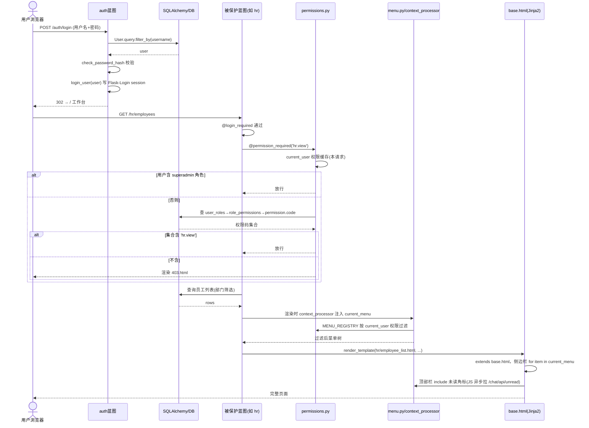
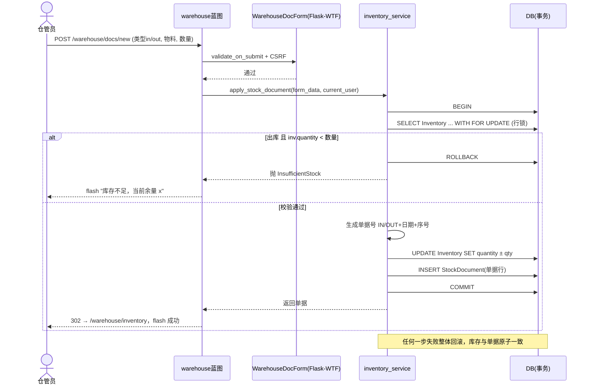
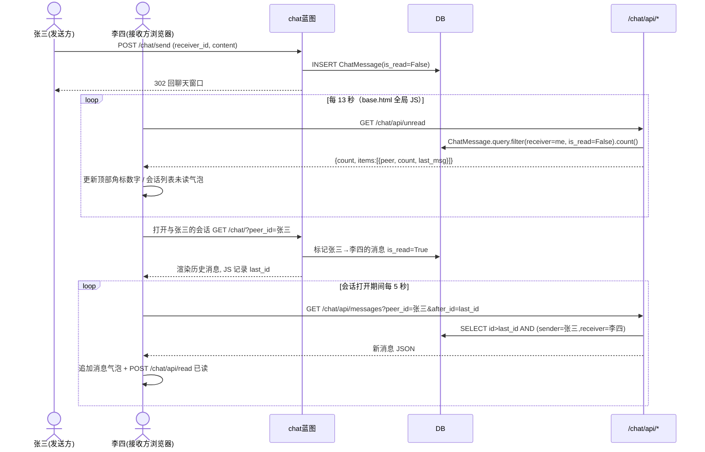
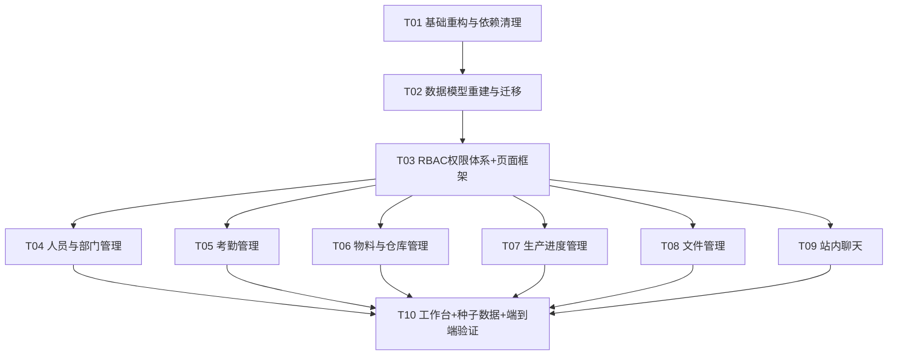

# 系统架构设计 + 任务分解：小型工厂管理系统（FlaskPaperCheck 改造）

> 架构师：高见远 ｜ 依据：`docs/PRD.md` v1.0 ｜ 状态：已完成
> 代码基线：`E:\个人项目\FlaskPaperCheck`（已现场核验 app 工厂 / config / models / routes / templates / migrations 现状）

---

## Part A · 系统设计

## 1. 实现方案

### 1.1 核心技术挑战与对策

| 挑战 | 对策 |
|---|---|
| 查重业务拆除干净（torch/gensim 等重依赖、4 个废弃模型、paper/history 蓝图、6 个迁移头） | T01 全量物理删除 + 依赖清零；迁移**重建而非叠加**（见 1.4） |
| 简单 RBAC：两级权限点 + 装饰器 + 菜单按权限渲染 | 权限点注册表（常量字典）+ `@permission_required` 装饰器 + Jinja context processor 注入过滤后的菜单（见 1.3-①） |
| 部门树（上下级 + 负责人）与 User 形成循环外键 | 邻接表（parent_id 自引用）+ `ForeignKey('users.id', use_alter=True)` 解循环；树在 Python 层内存组装（规模小，无需 CTE） |
| 库存随出入库单据自动增减，防超卖/并发错账 | 单据提交与库存更新放**同一事务**，出库前 `with_for_update()` 行锁校验余量（见 1.3-②） |
| 聊天实时性（不引入 WebSocket） | 服务端渲染 + AJAX 轮询：13s 间隔拉取未读消息数 + 最新消息（见 1.3-③） |
| 考勤统计（出勤/缺卡天数） | 打卡记录按 (user_id, date) 唯一约束，月度统计用日期区间查询 + Python 聚合（几百人规模无需 SQL 复杂聚合） |

### 1.2 框架选型确认（保持现有栈，零新增依赖）

- **保留**：Flask 2.2+ 应用工厂、Flask-SQLAlchemy 3.0.5、Flask-Login、Flask-WTF、Flask-Migrate(alembic)、PyMySQL、email-validator、Bootstrap5 CDN + Jinja2。
- **移除**：torch / gensim / sentence-transformers / scikit-learn / numpy / jieba / PyPDF2 / python-docx / beautifulsoup4 / requests / pdfkit / reportlab。
- **新增**：无。9 大模块全部可用现有栈实现（上传复用 werkzeug，轮询用原生 fetch，图表看板用 Bootstrap 卡片分列即可，P2 才考虑 ECharts）。
- **架构模式**：经典 Flask 分层单体 —— Route(蓝图/Controller) → Form(Flask-WTF 校验) → Model(SQLAlchemy) + Service(业务事务逻辑，仅库存/统计抽 service) + Utils(权限/菜单/时间过滤器)。

### 1.3 关键设计决策

#### ① RBAC 表设计与装饰器方案

- **权限点两级命名**：`模块.动作`，动作分两级语义——页面级（`view`，控制菜单/页面可达）与操作级（`manage`/`clock` 等）。全部权限点在 `app/utils/permissions.py` 的 `PERMISSION_REGISTRY` 中**唯一声明**（模块 → {权限点: 中文名}），该注册表同时服务于：角色勾选矩阵渲染、种子数据初始化、装饰器校验。三处共用一份定义，避免漂移。
- **表结构**：`Role` + `Permission` + `role_permissions` + `user_roles`（多对多）。`Permission` 表内容由种子脚本从注册表同步。
- **装饰器**：`@permission_required('hr.manage')`；持有内置角色 `超级管理员`（code=`superadmin`，is_builtin）直接放行；无权限渲染统一 `403.html`（不抛裸异常）。
- **菜单渲染**：`MENU_REGISTRY`（菜单配置：名称/图标/url/所需权限点/子项）+ context processor 注入 `current_menu`，base.html 按权限过滤渲染。聊天下拉未读角标由 base.html 内嵌 JS 轮询 `/chat/api/unread`。
- **数据权限**（部门主管只看本部门）P0 不做，但所有列表查询统一走 `base_query` 出口（每个 blueprint 内一个函数），P1 加部门过滤只改一处。

#### ② 库存增减的事务一致性

```
提交出入库单（POST /warehouse/docs）:
  with db.session.begin():                     # 单事务
    1. 校验物料/仓库有效、数量>0
    2. inv = Inventory.query.filter_by(...).with_for_update()   # MySQL InnoDB 行锁；SQLite 单写者天然串行
    3. 出库: 校验 inv.quantity >= qty，不足则 rollback 并 flash 错误
    4. 入库 +qty / 出库 -qty（无记录则入库新建，出库报错）
    5. 写入 StockDocument 单据行
  commit 成功 → flash 成功；任何一步失败 → 整体回滚，库存与单据原子一致
```
- 封装在 `app/services/inventory_service.py`（`apply_stock_document()`），路由层只调 service，便于单测。
- 阈值标红：库存列表查询时对比 `quantity <= warn_threshold`，模板加 `text-danger` 类；P0 无推送。

#### ③ 聊天轮询接口设计

- 数据模型仅一张 `ChatMessage`（sender/receiver/content/is_read/created_at），会话列表 = 按对方分组取最近一条 + 未读数。
- API（JSON，前后端不分离但保留轻量 JSON 端点）：
  - `GET /chat/api/unread` → `{count: n, items:[{partner_id, partner_name, count, last_message}]}`，base.html 顶部角标 + 会话列表共用，**轮询间隔 13s**。
  - `GET /chat/api/messages?peer_id=x&after_id=y` → 拉取 id > after_id 的新消息（增量）；收到后调用 `POST /chat/api/read` 标记已读。
  - 发送：常规表单 POST（服务端渲染回聊天页）即可，未读由对方轮询发现。
- 索引：`(receiver_id, is_read)`、`(sender_id, receiver_id, created_at)`，几百人规模绰绰有余。

#### ④ 考勤统计实现

- `AttendanceRecord(user_id, work_date:Date, check_in_at:DateTime, check_out_at:DateTime)`，`UniqueConstraint(user_id, work_date)` 保证每日一条；签到后重复点签到=更新（幂等）。
- 月度统计：取该月日期区间记录 + 工作日历（P0 简化：周一~周五为工作日，无节假日表），Python 算出勤天数（有 check_in）与缺卡天数（工作日无记录，且入职日期内、未离职）。

#### ⑤ 其他决策

- **部门树**：邻接表 + 内存递归组装（`Department.get_tree()`），管理页左侧树用嵌套 `<ul>` + Bootstrap collapse，不做拖拽。
- **文件可见范围**：`FactoryFile.visibility_type ∈ {all, roles}` + 关联表 `file_role_visibility(file_id, role_id)`；下载前校验 `visibility_type=='all' or 角色交集非空`；目录存储沿用 `UPLOAD_FOLDER`，磁盘文件名用 uuid 防冲突，原文件名存库。
- **工单状态机**：工单 `pending→in_progress→completed→accepted`；工序 `pending→in_progress→completed`。流转仅在详情页"下一步"按钮 + 后端校验合法迁移，不做任意跳转。

### 1.4 迁移重建策略（重点）

**决策：删除旧迁移历史，全新初始化，而非在旧 head 上叠加。**

理由：
1. 旧 head 有 6 个版本、且业务模型（Paper/CheckRecord 等 4 表）全废弃——叠加式迁移会产生"先建后删"的垃圾历史；
2. User 表结构大改（加 employee_no/department_id/多角色等），旧 email 唯一非空约束与现状冲突，diff 迁移极易出错；
3. PRD 明确旧查重数据全部废弃，无存量数据包袱，重建零成本。

操作步骤（T02 执行）：
```
1. 备份并删除 migrations/versions/*.py（保留 env.py）
2. 删除旧库或 DROP 旧表（paper_check.db / setup.sql 库）
3. 删除 alembic_version 表（或整个库重建）
4. flask db migrate -m "factory_mgmt_init"   # 基于新 models 包一次性生成
5. flask db upgrade
6. python scripts/seed.py                    # 种子：角色/权限点/超管账号/示例部门
```

---

## 2. 文件列表及相对路径

图例：`[新]` 新建　`[改]` 改造现有　`[删]` 删除

### 2.1 根目录与配置
```
[改] requirements.txt                 # 精简为 7 个依赖
[改] config.py                        # 移除 DOC2VEC_MODEL_PATH/ALLOWED_EXTENSIONS 旧值；新增 TIMEZONE='Asia/Shanghai'、MAX_CONTENT_LENGTH=50MB、UPLOAD 扩展白名单
[改] run.py                           # 不变（视核验结果微调）
[新] scripts/seed.py                  # 种子数据：权限点/内置角色/超管/示例部门/示例物料仓库
[删] app.py.bak、verify_p1_tmp.py、setup.sql、models/（doc2vec 模型目录）、paper_check_test.db
```

### 2.2 app 应用主体
```
[改] app/__init__.py                  # 注册 10 个新蓝图；引入 context processor（菜单/未读数/时间过滤器）
[删] app/models.py                    # 单文件 → 拆为 app/models/ 包
[删] app/forms.py                     # 单文件 → 拆为 app/forms/ 包
[新] app/models/__init__.py           # 统一 re-export 所有模型（迁移发现用）
[新] app/models/user.py               # User、user_roles
[新] app/models/rbac.py               # Role、Permission、role_permissions
[新] app/models/org.py                # Department
[新] app/models/attendance.py         # AttendanceRecord
[新] app/models/production.py         # WorkOrder、WorkOrderStep
[新] app/models/material.py           # MaterialCategory、Material
[新] app/models/warehouse.py          # Warehouse、Inventory、StockDocument
[新] app/models/file.py               # FileCategory、FactoryFile、file_role_visibility
[新] app/models/chat.py               # ChatMessage

[删] app/routes/paper.py、app/routes/history.py
[改] app/routes/auth.py               # 去掉 register 自助注册（工厂员工由管理员开户）；保留 login/logout/profile、新增 /auth/password 修改密码
[改] app/routes/main.py               # 工作台首页（统计卡片：我的工单/待办/库存预警数/未读消息）
[新] app/routes/rbac.py               # 角色列表/新建/权限矩阵/用户挂角色
[新] app/routes/hr.py                 # 员工 CRUD + 离职停用；部门树 CRUD + 负责人
[新] app/routes/attendance.py         # 打卡、个人记录、月度统计
[新] app/routes/production.py         # 工单 CRUD、工序流转、看板
[新] app/routes/material.py           # 物料分类/档案 CRUD
[新] app/routes/warehouse.py          # 仓库档案、出入库单据、库存列表
[新] app/routes/files.py              # 分类、上传、列表、下载
[新] app/routes/chat.py               # 会话页、发送、JSON API（unread/messages/read）

[删] app/utils/similarity.py、text_preprocess.py、file_parser.py、report.py、stopwords.txt
[新] app/utils/permissions.py         # PERMISSION_REGISTRY、@permission_required、权限查询与缓存
[新] app/utils/menu.py                # MENU_REGISTRY + 菜单过滤
[新] app/utils/time_utils.py          # now()（本地时区）、Jinja 过滤器 fmt_dt
[新] app/services/__init__.py
[新] app/services/inventory_service.py # apply_stock_document（事务）
[新] app/services/attendance_service.py # 月度统计聚合
[新] app/services/chat_service.py      # 会话列表/未读聚合
[删] app/forms.py（旧）→ [新] app/forms/auth.py、hr.py、rbac.py、attendance.py、production.py、material.py、warehouse.py、files.py、chat.py

[删] app/uploads/（旧查重上传目录，改为 data/uploads 由 config 统一）
```

### 2.3 模板（app/templates/，全部继承改造后的 base.html）
```
[改] base.html            # 顶部栏（系统名/消息角标/用户菜单）+ 左侧权限导航 + 内容区
[改] login.html           # 品牌区改"工厂管理系统"；[删] register.html
[改] profile.html         # 员工信息 + 修改密码
[新] errors/403.html、errors/404.html
[新] main/index.html      # 工作台
[新] rbac/role_list.html、rbac/role_form.html（权限勾选矩阵）
[新] hr/employee_list.html（部门树+表格）、hr/employee_form.html、hr/department.html（树管理）
[新] attendance/clock.html、attendance/records.html、attendance/monthly.html
[新] production/order_list.html、production/order_form.html、production/order_detail.html（工序时间线）、production/board.html
[新] material/category_list.html、material/material_list.html、material/material_form.html
[新] warehouse/warehouse_list.html、warehouse/doc_form.html、warehouse/doc_list.html、warehouse/inventory.html
[新] files/index.html（分类树+列表+上传模态框）
[新] chat/index.html（两栏布局+轮询 JS）
[新] _macros.html         # 分页宏、表格空状态宏等公共片段
```

### 2.4 迁移
```
[删] migrations/versions/*.py（6 个旧版本全删）
[新] migrations/versions/factory_mgmt_init.py   # 由 flask db migrate 自动生成
```

---

## 3. 数据结构和接口（类图）

### 3.1 SQLAlchemy 模型 classDiagram

```mermaid
classDiagram
    class User {
        +int id PK
        +str username UK "登录名，唯一"
        +str employee_no UK "工号，唯一"
        +str name "真实姓名"
        +str email "可空"
        +str phone "可空"
        +str password_hash
        +str position "岗位"
        +int department_id FK>departments.id "单部门归属，可空"
        +date hire_date "入职日期"
        +date leave_date "离职日期，可空"
        +bool is_active "离职=停用"
        +datetime created_at
        +bool check_password(pwd)
        +set_password(pwd)
        +list roles_rel "roles 多对多"
    }
    class Role {
        +int id PK
        +str code UK "superadmin/leader/keeper/producer/staff/archivist"
        +str name
        +bool is_builtin "内置角色不可删"
        +str remark
    }
    class Permission {
        +int id PK
        +str code UK "如 hr.manage"
        +str name "中文名"
        +str module "所属模块分组"
    }
    class Department {
        +int id PK
        +str name
        +int parent_id FK>departments.id "自引用树"
        +int leader_id FK>users.id "use_alter 解循环"
        +int sort_order
        +bool is_active
        +get_tree() list
    }
    class AttendanceRecord {
        +int id PK
        +int user_id FK>users.id
        +date work_date "打卡日期"
        +datetime check_in_at
        +datetime check_out_at
        +"UK(user_id, work_date)"
    }
    class WorkOrder {
        +int id PK
        +str order_no UK "如 WO20250601001"
        +str product_name
        +int quantity
        +date due_date "交期"
        +int leader_id FK>users.id "负责人"
        +str status "pending/in_progress/completed/accepted"
        +int created_by FK>users.id
        +datetime created_at
    }
    class WorkOrderStep {
        +int id PK
        +int work_order_id FK>work_orders.id
        +str name "工序名"
        +int seq "顺序号"
        +str status "pending/in_progress/completed"
        +int operator_id FK>users.id "可空"
        +datetime started_at
        +datetime finished_at
        +str remark
    }
    class MaterialCategory {
        +int id PK
        +str name
        +int parent_id FK "自引用，可空"
    }
    class Material {
        +int id PK
        +str code UK "物料编码"
        +str name
        +str spec "规格"
        +str unit "单位"
        +int category_id FK>material_categories.id
        +bool is_active
    }
    class Warehouse {
        +int id PK
        +str name UK
        +str location
        +bool is_active
    }
    class Inventory {
        +int id PK
        +int warehouse_id FK>warehouses.id
        +int material_id FK>materials.id
        +int quantity ">=0"
        +int warn_threshold "预警阈值，默认0"
        +"UK(warehouse_id, material_id)"
    }
    class StockDocument {
        +int id PK
        +str doc_no UK "单据号 IN/OUT 前缀"
        +str doc_type "in/out"
        +int warehouse_id FK>warehouses.id
        +int material_id FK>materials.id "P0 单物料/单"
        +int quantity
        +int handler_id FK>users.id "经手人"
        +int related_order_id FK>work_orders.id "关联工单，可空(P1 用)"
        +str remark
        +int created_by FK>users.id
        +datetime created_at
    }
    class FileCategory {
        +int id PK
        +str name
        +int parent_id FK "自引用，可空"
    }
    class FactoryFile {
        +int id PK
        +str name "显示名"
        +str original_filename
        +str stored_filename "uuid 防冲突"
        +str file_ext
        +int size_bytes
        +int category_id FK>file_categories.id
        +str visibility_type "all/roles"
        +int uploaded_by FK>users.id
        +datetime created_at
        +bool is_active
    }
    class ChatMessage {
        +int id PK
        +int sender_id FK>users.id
        +int receiver_id FK>users.id
        +text content
        +bool is_read "默认 False"
        +datetime created_at
        +"IX(receiver_id,is_read) IX(sender,receiver,created_at)"
    }

    User "1" --> "0..*" AttendanceRecord : 打卡
    User "1" --> "0..*" ChatMessage : 发送/接收
    User "0..*" -- "0..*" Role : user_roles
    Role "0..*" -- "0..*" Permission : role_permissions
    User "0..*" --> "0..1" Department : 归属
    Department "1" --> "0..1" User : 负责人(use_alter)
    Department "0..*" --> "0..1" Department : parent
    WorkOrder "1" *-- "1..*" WorkOrderStep : 工序
    User "1" --> "0..*" WorkOrder : 负责人
    MaterialCategory "0..*" --> "0..1" MaterialCategory : parent
    Material "0..*" --> "0..1" MaterialCategory
    Inventory "0..*" --> "1" Warehouse
    Inventory "0..*" --> "1" Material
    StockDocument "0..*" --> "1" Warehouse
    StockDocument "0..*" --> "1" Material
    StockDocument "0..*" --> "0..1" WorkOrder : P1关联
    FactoryFile "0..*" --> "0..1" FileCategory
    FactoryFile "0..*" -- "0..*" Role : file_role_visibility
```



### 3.2 核心路由/接口清单（方法 + 路径 + 权限点）

> 通用约定：全部页面 `@login_required`；权限点省略处表示仅登录即可。写操作一律 POST + Flask-WTF CSRF。

| 蓝图 | 方法+路径 | 权限点 | 说明 |
|---|---|---|---|
| auth | GET/POST `/auth/login`、GET `/auth/logout` | 无/登录 | 登录、登出 |
| auth | GET/POST `/auth/profile`、`/auth/password` | 登录 | 个人信息、改密 |
| main | GET `/` | 登录 | 工作台 |
| hr | GET `/hr/employees`、`?dept_id=` | `hr.view` | 员工列表（左部门树筛选+搜索+分页） |
| hr | GET/POST `/hr/employees/new`、`/hr/employees/<id>/edit` | `hr.manage` | 新建/编辑（表单内多选角色） |
| hr | POST `/hr/employees/<id>/toggle` | `hr.manage` | 离职停用/复用 |
| hr | GET `/hr/departments`、POST `/hr/departments/new`、`/<id>/edit`、`/<id>/delete` | `dept.manage` | 部门树 CRUD、负责人 |
| rbac | GET `/rbac/roles`、GET/POST `/rbac/roles/new`、`/<id>/edit` | `rbac.manage` | 角色 CRUD + 权限勾选矩阵 |
| rbac | GET `/rbac/permissions` | `rbac.manage` | 权限点总览（只读，来自注册表） |
| attendance | GET/POST `/attendance/clock` | `attendance.clock` | 签到/签退大按钮 + 当日状态 |
| attendance | GET `/attendance/records`、`/attendance/monthly` | `attendance.view`（他人需 `attendance.view_all`） | 个人记录 / 月度统计 |
| production | GET `/production/orders`、GET/POST `/production/orders/new`、`/<id>/edit` | `production.view` / `production.manage` | 工单 CRUD |
| production | GET `/production/orders/<id>`、POST `/<id>/status`、`/<id>/steps/<sid>/status` | `production.manage` | 详情 + 工单/工序状态流转（校验合法迁移） |
| production | GET `/production/board` | `production.view` | 看板（按状态分列卡片） |
| material | GET/POST `/material/categories*`、`/material/list`、`/material/new`、`/<id>/edit` | `material.manage` | 分类/物料 CRUD |
| warehouse | GET/POST `/warehouse/warehouses*` | `warehouse.manage` | 仓库档案 CRUD |
| warehouse | GET/POST `/warehouse/docs/new`、GET `/warehouse/docs` | `warehouse.manage` | 出入库单据录入/流水 |
| warehouse | GET `/warehouse/inventory` | `warehouse.view` | 库存列表（低于阈值红色） |
| files | GET `/files/`、`?cat_id=` | `files.view` | 分类树 + 文件列表（按可见范围过滤） |
| files | GET/POST `/files/upload`、`/files/categories*` | `files.manage` | 上传（分类+可见范围）、分类管理 |
| files | GET `/files/<id>/download` | `files.view` + 可见范围校验 | 下载（send_file） |
| chat | GET `/chat/`、`?peer_id=` | 登录 | 会话列表 + 聊天窗口 |
| chat | POST `/chat/send` | 登录 | 发送消息（表单） |
| chat | GET `/chat/api/unread` | 登录 | JSON：未读总数+每会话未读（轮询 13s） |
| chat | GET `/chat/api/messages?peer_id&after_id` | 登录 | JSON：增量新消息 |
| chat | POST `/chat/api/read` | 登录 | JSON：标记已读 |

---

## 4. 程序调用流程（时序图）

### 4.1 登录 + 权限校验 + 菜单渲染



### 4.2 出入库单据提交 → 库存更新（事务一致性）



### 4.3 聊天发送 + 轮询拉取未读



---

## Part B · 任务分解

## 5. 依赖包（requirements.txt 最终内容）

```
Flask>=2.2.5
Flask-SQLAlchemy==3.0.5
Flask-Login>=0.6.3
Flask-WTF==1.1.1
Flask-Migrate==4.0.4
PyMySQL==1.0.2
email-validator==2.1.0
```
新增：**无**。（聊天轮询用原生 fetch；上传用 werkzeug 自带；图表看板 P0 用纯 CSS 分列卡片。）

---

## 6. 任务列表（有序，共 10 个）

| ID | 任务名 | 涉及文件 | 依赖 | 验收标准 | 优先级 |
|---|---|---|---|---|---|
| **T01** | 基础重构与依赖清理 | requirements.txt、config.py、app/__init__.py（临时只留 auth/main）、删 routes/paper.py+history.py、删 utils 4 文件+stopwords.txt、删 app/models.py 旧表定义之外部分、删 register.html 等废弃模板、删根目录垃圾文件 | 无 | ① `pip install -r requirements.txt` 在干净 venv 成功且无 torch/gensim；② `flask run` 启动正常，登录页可打开；③ 全库 grep `paper|similarity|doc2vec|gensim|torch` 无业务残留（docs 除外） | P0 |
| **T02** | 数据模型重建与迁移 | app/models/ 包 10 个文件、migrations/versions 清空重建、config.py 时区项、scripts/seed.py（权限点+内置角色+超管） | T01 | ① `flask db migrate && flask db upgrade` 一次成功生成全部 15 张表；② `python scripts/seed.py` 写入权限点/角色/超管；③ 模型间外键/唯一约束与设计一致（User↔Department 循环外键 use_alter 生效） | P0 |
| **T03** | RBAC 权限体系 + 页面框架 | app/utils/permissions.py、menu.py、time_utils.py、routes/rbac.py、forms/rbac.py、templates/base.html（侧边栏+顶部栏+角标占位）、rbac/*.html、errors/403.html、errors/404.html、auth.py 改造（去注册+改密） | T02 | ① 角色矩阵页可勾选权限并保存；② 无权限访问返回 403 页；③ 超管全菜单可见，普通角色菜单按权限过滤；④ login_required 未登录跳登录 | P0 |
| **T04** | 人员与部门管理 | routes/hr.py、forms/hr.py、templates/hr/*.html（员工列表含部门树筛选、员工表单含角色多选、部门树管理页） | T03 | ① 员工 CRUD + 离职停用（停用后无法登录、数据保留）；② 部门树增删改、指定负责人、员工归属部门；③ 工号/用户名唯一校验 | P0 |
| **T05** | 考勤管理 | routes/attendance.py、forms/attendance.py、services/attendance_service.py、templates/attendance/*.html | T03（依赖 users 种子，联调需 T04） | ① 每日签到/签退各一次（重复点击幂等）；② 个人记录可查；③ 月度统计正确（出勤/缺卡天数，排除离职期间） | P0 |
| **T06** | 物料与仓库管理 | routes/material.py、routes/warehouse.py、forms/ 两个、services/inventory_service.py、templates/material/*.html、warehouse/*.html | T03 | ① 物料分类/档案 CRUD、编码唯一；② 出入库单据提交后库存同事务增减（并发下无负库存）；③ 库存列表低于阈值红色标注；④ 出库余量不足被拒绝并整体回滚 | P0 |
| **T07** | 生产进度管理 | routes/production.py、forms/production.py、templates/production/*.html（列表/表单/详情时间线/看板） | T03 | ① 工单 CRUD（单号自动生成唯一）；② 工序状态流转仅允许合法迁移；③ 看板按状态分列展示 | P0 |
| **T08** | 文件管理 | routes/files.py、forms/files.py、templates/files/index.html、config.py 上传白名单 | T03 | ① 上传（分类+可见范围 all/roles）成功落盘 data/uploads；② 越权下载被拒；③ 分类管理与文件列表/下载正常 | P0 |
| **T09** | 站内聊天 | routes/chat.py、forms/chat.py、services/chat_service.py、templates/chat/index.html、base.html 增未读角标轮询 JS | T03 | ① 一对一收发正常；② 顶部角标 13s 轮询更新；③ 打开会话自动已读；④ 会话列表含最近联系人与未读数 | P0 |
| **T10** | 工作台、种子数据与端到端验证 | routes/main.py、templates/main/index.html、templates/_macros.html、scripts/seed.py 扩充（示例部门/员工/物料/仓库/工单）、README 更新部署说明 | T04~T09 | ① 六角色种子账号各登录验证其模块可用；② 工作台统计卡片数字正确；③ 全流程走查：建员工→打卡→建工单→出入库→传文件→聊天 无阻断；④ MySQL 与 SQLite 双配置各跑通一遍 | P0 |

> 说明：任务数超出我个人模板的 5 个上限，系按主理人指定的实现顺序与"每任务≥3 文件、按模块分组"原则合并为 10 个；T05~T09 之间互相独立、均只依赖 T03，可并行。

---

## 7. 共享知识（跨文件约定，工程师必读）

1. **权限点命名**：`模块.动作`，全部小写。固定枚举：`hr.view/hr.manage`、`dept.manage`、`rbac.manage`、`attendance.clock/attendance.view/attendance.view_all`、`production.view/production.manage`、`material.manage`、`warehouse.view/warehouse.manage`、`files.view/files.manage`。**只在 `app/utils/permissions.py` 的 PERMISSION_REGISTRY 声明一次**，页面/菜单/种子全部引用它，禁止在模板里硬编码权限字符串。
2. **蓝图 URL 前缀**：auth=/auth、main=/、hr=/hr、rbac=/rbac、attendance=/attendance、production=/production、material=/material、warehouse=/warehouse、files=/files、chat=/chat。endpoint 名 = `蓝图.函数`。
3. **模板继承**：所有页面 `` + ``；公共片段放 `_macros.html`；新菜单项只改 `MENU_REGISTRY`，不改 base.html。
4. **时间字段约定（决策）**：**全部使用本地时间（Asia/Shanghai，naive datetime）入库**——内网单机单时区，统一本地时间让考勤"按天"逻辑最简单；统一经 `app/utils/time_utils.now()` 取当前时间，禁止散落 `datetime.now()`/`utcnow()`；展示用 Jinja 过滤器 `fmt_dt`（格式 `YYYY-MM-DD HH:mm`）。若未来多时区再统一迁 UTC。
5. **表单**：一律 Flask-WTF（自带 CSRF）；列表页分页用 `page/per_page=20` query 参数 + `_macros.html` 分页宏。
6. **删除策略**：业务数据一律软删/停用（`is_active=False`），不做物理删除（部门、物料、仓库、文件、用户同此）。
7. **种子数据脚本**：`scripts/seed.py`，幂等（存在即跳过）；内置角色 code：`superadmin/leader/keeper/producer/staff/archivist`；超管账号 `admin/admin123`（首次登录后改密）。
8. **JSON 接口**仅限 chat 三个端点，返回 `{code:0, data:..., message:'ok'}`；非 200 时 code 非 0。
9. **flash 分类**沿用 bootstrap alert 类名：success/danger/warning/info。

---

## 8. 任务依赖图



---

## 9. 待明确事项（风险 / 决策点，请主理人确认）

1. **旧 User 数据是否保留**：按 PRD 默认废弃重建。若需保留历史用户做"员工导入基础"，T02 前需先写数据迁移脚本（把旧 users 行映射到新表，email 可空化），会**增加 T02 工作量约半天**。
2. **时间存储选了本地时间**（见共享知识 §4）：如果客户服务器跨时区或要求 UTC 审计，需在 T02 前定稿，迁移成本最低。
3. **自助注册入口移除**：工厂场景默认员工由管理员开户。若需保留注册页需说明审批人是谁，否则建议按本设计删除。
4. **P0 出入库单据为"单物料/单"**（material_id 直接放单据表）：如仓管习惯一次录多种物料的复合单，需改为单据-行项两表（T06 +0.5 天）。
5. **考勤缺卡判定**：P0 简化为"工作日（周一~五）无签到记录即缺卡"，无节假日/班次配置（P2）。若客户节假日差异大，建议把"考勤规则配置"提前。
6. **Bootstrap5 走 CDN**：内网若无法访问公网 CDN，需下载静态文件到 `app/static/vendor/`（T03 内处理，影响小）。
7. **聊天轮询 13s**：几百人全开页面约每秒几十次轻量查询，MySQL 无压力；SQLite 并发写场景下建议聊天库仍用 MySQL。
8. **superadmin 角色绕过权限校验**是硬编码放行：若需要"超级管理员也受限"的合规要求请反馈。
